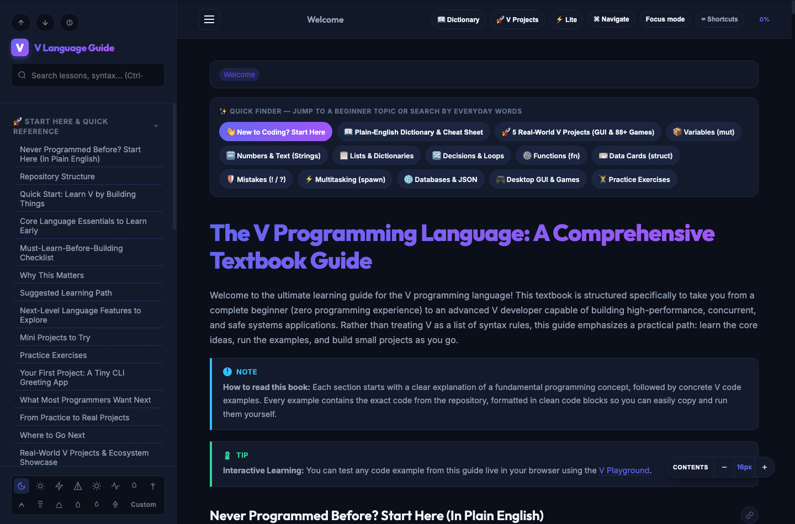

# Comprehensive Vlang Tutorial

Welcome to the complete Zero-to-Hero tutorial for Vlang! This guide covers everything from basic variables to advanced concurrency and standard library usage.



## What this website can do

The interactive guide turns the V tutorial into a complete, beginner-friendly learning experience that runs smoothly even on older or low-resource devices:

- **Plain-English Explanations Everywhere**: Every chapter, lesson, and "Under the Hood" section begins with a simple, everyday explanation and real-world analogy so even people who have never programmed before can learn easily.
- **Built-in Plain-English Dictionary & Cheat Sheet (`D` shortcut)**: Instant reference popup explaining programming words in everyday language alongside a `"How Do I...?"` copy-paste V cheat sheet.
- **Smart Everyday-Word Search (`/` or `Ctrl+K`)**: Type everyday words like `"change"`, `"list"`, `"text"`, `"mistake"`, `"window"`, or `"game"` and automatically find the matching V concepts (`mut`, `arrays`, `strings`, `options/results`, `GUI`, `SDL`), plus filter by **All**, **Chapters**, **Lessons**, **Exercises**, or **Dictionary** and click quick-topic chips.
- **Low-Resource & Lite Mode (`L` shortcut)**: Uses modern `content-visibility: auto` off-screen rendering, SVG sprite deduplication, and on-demand syntax highlighting so the page opens fast and uses minimal RAM and CPU. **Lite Mode** automatically turns on for low-resource devices (or with one click) to disable heavy blurs and animations.
- **Collapsible Navigation & Deep Dives**: Browse lessons through a collapsible sidebar with chapter, section, and subtopic navigation, plus collapsible **Quick Access**, **Under the Hood**, and **Exercise Solution** panels that remain searchable with browser Find-in-Page (`Ctrl+F` / `Cmd+F`).
- **Bookmarks, Progress Tracking & Auto-Resume**: Bookmark important lessons, check off completed lessons with chapter progress bars, and automatically resume from where you left off.
- **Themes & Reading Comfort**: Switch between Dark, Light, Cyberpunk, and custom color themes, adjust font size, or enter **Focus Mode** (`F`) to hide distractions.
- **Interactive V Playground Integration**: Copy code examples or launch them directly in the [V Playground](https://play.vlang.io/).

### Keyboard shortcuts

- `/` or `Ctrl+K` (`Cmd+K`): Open instant search & topic filter
- `D`: Open the Plain-English Dictionary & `"How Do I...?"` Cheat Sheet
- `F`: Toggle distraction-free Focus Mode
- `L`: Toggle Lite Mode (low-CPU / low-RAM performance mode)
- `Esc`: Close any open dialog or exit Focus Mode

### How the site is built

The website is generated from the source builder script into the published page at docs/index.html, so updates to the guide content or interface are reflected by rebuilding the site.

## Repository Layout

The repository is organized by learning progression, so it is easier to move from beginner concepts to more practical application topics:

- Foundations: `variables_and_constants/`, `primitive_types/`, `control_flow/`, and `functions/`
- Data and program design: `structs/`, `error_handling/`, `modules/`, and `testing/`
- Applied topics: `concurrency/`, `channels/`, `json_and_orm/`, `sqlite/`, and `notes_api/`
- Reference material: `language_updates_and_stdlib/` now has a clearer split between newer language features and grouped standard library examples

This structure makes it easier to jump straight to the concept you want to study and to understand how the topics build on one another.

### Recommended way to use the repo

1. Start with the foundational folders to learn the core syntax and mindset.
2. Move to data modeling and correctness topics once the basics feel comfortable.
3. Finish with the applied examples to see V used in real-world style programs.

### Contributing a new lesson

- Keep each topic in its own folder.
- Use numbered lesson folders such as `01_topic_name/` and `02_topic_name/` for consistency.
- Add a short explanation or README when a topic needs more context.
- Keep examples runnable and focused on one idea at a time.

## Real-World V Projects & Ecosystem Showcase

Want to see what you can build once you learn V? Check out these complete desktop GUI toolkits, visual app builders, and arcade game suites built in V:

| Project | What You Can Build With It | Highlights |
| :--- | :--- | :--- |
| **[simple_gg](https://github.com/codecaine-zz/simple_gg)** | Cross-platform GPU-accelerated desktop apps & games (macOS, Linux, Windows) | Built on V's `gg` & Sokol GPU. Features 260+ themes, custom GPU shaders, 47 studio apps, and 45 `vlang_utils` helper modules. |
| **[vlang_simplegui](https://github.com/codecaine-zz/vlang_simplegui)** | Native macOS Cocoa desktop apps & visual tools | 115+ native controls, 50+ themes, 140+ demos, and a built-in Delphi/VB-style drag-and-drop **Visual UI Designer**. |
| **[vlang_webview_rad_studio](https://github.com/codecaine-zz/vlang_webview_rad_studio)** | Cross-platform visual desktop apps with HTML/CSS/JS UI & native V backend | Visual Rapid Application Development (RAD) Studio & enterprise desktop suite with 70+ components and 76 themes across macOS, Windows, and Linux. |
| **[vlang_sdl2_games](https://github.com/codecaine-zz/vlang_sdl2_games)** | 88+ playable 2D & 3D arcade games (Sprite & Real Audio Edition) | Built with `vlang/sdl`. Includes PNG sprite sheets, 16-bit WAV sound & background music synthesizers, and instant F5/F9 save states. |
| **[sdl_games](https://github.com/codecaine-zz/sdl_games)** | 88 playable 2D & 3D arcade games (Zero-Asset Procedural Edition) | 100% self-contained single-file games—every graphic, font, and sound effect is generated in pure V math with zero external image or audio files! |
| **[vlang_macos_webview_app_template](https://github.com/codecaine-zz/vlang_macos_webview_app_template)** | Lightweight macOS desktop app starter | Clean starter template for pairing a native V backend with a macOS Webview window. |

> [!TIP]
> **Interactive Viewer**: Read this guide and other tutorials as a responsive HTML site on the [Markdown Tutorials Live App](https://codefreelance.net/apps/markdown_tutorials/) (source code available in the [GitHub Repository](https://github.com/codecaine-zz/markdown_tutorials)).

> [!NOTE]
> **Enhanced HTML Textbook Version**: We now include a premium, interactive HTML documentation site compiled locally from this guide. You can read it live at **[codefreelance.net/apps/vlang.html](https://codefreelance.net/apps/vlang.html)** or open it locally at **[docs/index.html](docs/index.html)**. It features a collapsible navigation tree, dynamic search filters, dark/light/cyberpunk theme togglers, and interactive links to run code examples in the [V Playground](https://play.vlang.io/) with automatic code loading.

## Why V?

V is a statically typed, compiled programming language designed for building maintainable, highly performant software. It shares similarities with Go and is influenced by Rust, Swift, and Julia.

### Core Philosophy

- **Zero Dependencies**: The entire language, compiler, and standard library have no external dependencies. Everything you need is compiled into a single, clean codebase.
- **Extreme Compilation Speeds**: V compiles to native C code (and from there to machine code) or directly to machine code/WebAssembly in under a second. Rebuilding the entire V compiler itself takes less than 1.5 seconds.
- **Safety**: Immortality by default (no globals, immutable variables, immutable struct fields by default), bounds checking, no null pointers, and strict control over variable scopes.
- **No Heavy Runtime**: V compiles directly to native binaries without a Virtual Machine (VM), interpreter, or heavy runtime library. Resulting executables are extremely lightweight (usually < 1MB).

### Use-Case Guidance: Choosing V

| Scenario / Goal                | Choose V when...                                                                                         | Choose Go when...                                                       | Choose Rust when...                                                              | Choose C when...                                                           |
| :----------------------------- | :------------------------------------------------------------------------------------------------------- | :---------------------------------------------------------------------- | :------------------------------------------------------------------------------- | :------------------------------------------------------------------------- |
| **Lightweight CLI Tools**      | **Highly Recommended**. Tiny binaries, instant startup, zero dependencies, easy arguments/flags parsing. | Binaries are larger (~5-15MB) and startup is slightly slower due to GC. | Great, but development speed is slower and setup is more complex.                | Good, but lack of modern string handling and collections makes it tedious. |
| **Fast-Booting Microservices** | **Excellent**. Low memory overhead, instant boot (ideal for Serverless/Docker environments).             | Excellent standard library, but higher memory footprint and GC pauses.  | Excellent performance, but longer compilation cycles and steeper learning curve. | Too low-level, unsafe web-facing library ecosystem.                        |
| **Embedded & Systems**         | **Excellent**. Easily compiles to C, runs on bare-metal or resource-constrained boards.                  | Not suitable due to garbage collector and runtime footprint.            | **Excellent**. Safe concurrency and hardware control, though more complex.       | The classic choice, but lacks V's safety guards against memory corruption. |
| **Desktop GUI Apps**           | **Excellent**. Built-in `gg` graphics library and simple Webview bindings.                               | Not ideal; lacks first-class native desktop GUI support.                | Possible, but complex ecosystem.                                                 | Possible, but extremely verbose and unsafe.                                |

## Prerequisites & Environment Setup

### 1. Compiling V from Source (Official Method)

> [!IMPORTANT]
> **Do not install V using package managers like Homebrew.** Homebrew is not officially supported by the creators of V and frequently distributes outdated builds or non-standard directory structures that break tooling. Always compile V directly from source.

To compile and install V from source:

```bash
# 1. Clone the official V repository
git clone https://github.com/vlang/v
cd v

# 2. Compile V (takes under 30 seconds)
make
```

### 2. Make V Available Globally (Symlink)

To make `v` available globally from any terminal directory:

```bash
# Create a global symlink (e.g. /usr/local/bin/v)
sudo ./v symlink
```

Verify your installation:

```bash
v version
```

### 3. V-Analyzer Setup for IDEs (VSCode / Antigravity IDE)

To get instant autocomplete, hover documentation, and diagnostics in your IDE:

1. Install the `v-analyzer` extension.
2. In your `v-analyzer` settings (or `config.toml`), set `custom_vroot` to the absolute path of your compiled V repository (e.g., `/Users/yourusername/v` or `~/v`). This ensures `v-analyzer` accurately indexes the `vlib` standard library and language modules.

---

> [!IMPORTANT]
> **Vlang Textbook Learning Guide & Code Examples**
> All code examples and detailed, step-by-step programming lessons have been moved to the dedicated textbook guide: **[The V Programming Language: A Comprehensive Textbook Guide.md](https://github.com/codecaine-zz/V-Programming-Comprehensive-Guide/blob/master/The%20V%20Programming%20Language:%20A%20Comprehensive%20Textbook%20Guide.md)** (or **[vlang-complete-guide.md](https://github.com/codecaine-zz/V-Programming-Comprehensive-Guide/blob/master/vlang-complete-guide.md)**).
>
> Please use [The V Programming Language: A Comprehensive Textbook Guide.md](https://github.com/codecaine-zz/V-Programming-Comprehensive-Guide/blob/master/The%20V%20Programming%20Language:%20A%20Comprehensive%20Textbook%20Guide.md) (or **[vlang-complete-guide.md](https://github.com/codecaine-zz/V-Programming-Comprehensive-Guide/blob/master/vlang-complete-guide.md)**) as your primary resource for learning V, as it features a structured, school-book syllabus designed specifically for new and experienced developers alike.

---

## Official Documentation & Interactive Guide

For comprehensive and up-to-date information about V, please refer to:

- **[Interactive HTML Guide (Live Web Version)](https://codefreelance.net/apps/vlang.html)** - Read the compiled guide online on the web.
- **[Interactive HTML Guide (Local Version)](docs/index.html)** - The premium, interactive HTML version of this textbook with built-in search, theme togglers, and V Playground integration.
- **[V Official Documentation](https://github.com/vlang/v/blob/master/doc/docs.md)** - Complete reference guide for the V programming language.
- **[Vlang Complete Guide](https://github.com/codecaine-zz/V-Programming-Comprehensive-Guide/blob/master/vlang-complete-guide.md)** - Comprehensive textbook and learning guide for V.
- **[Markdown Tutorials Live App](https://codefreelance.net/apps/markdown_tutorials/)** - Interactive HTML viewer featuring this Vlang guide alongside other programming tutorials ([GitHub Repository](https://github.com/codecaine-zz/markdown_tutorials)).

### V Playground Integration

The interactive HTML guide integrates directly with the [V Playground](https://play.vlang.io/):

- **Run in Playground**: Pre-loads the specific V code block directly into the playground editor using the `base64` query parameter.
- **Copy & Open**: Copies the V code block to your clipboard and opens the playground pre-loaded with the exact code snippet.

### Rebuilding the Interactive HTML Guide

If you update `The V Programming Language: A Comprehensive Textbook Guide.md`, you can recompile the interactive HTML version at any time by running:

```bash
v run build.vsh
```
